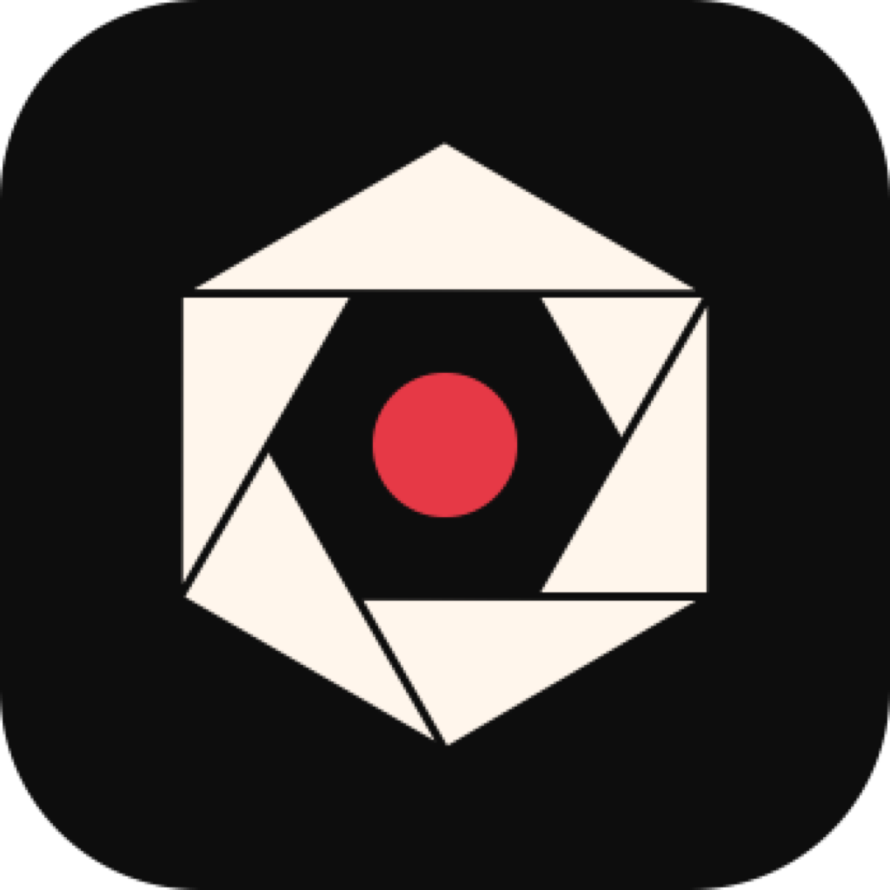

<div align="center">



# Mieru

### On-device camera AI that sees, decides, and speaks: Gemma 4, D1A and Irodori TTS on iPhone.

**見える** (mieru): *"to see / to be visible"*

<br>

[](https://swift.org)
[](https://developer.apple.com/ios/)
[](https://github.com/ml-explore/mlx-swift)
[](https://developer.apple.com/documentation/coreml)
[](https://huggingface.co/mlx-community/gemma-4-e2b-it-4bit)

<br>

</div>

---

## Overview

Mieru is an iPhone app for describing the world out loud. Point the camera at something and tap 「しらべる」.
1. **Gemma 4 E2B**, an on-device vision-language model, says what it sees: brands, products, text, places and objects.
2. **D1A**, a small decision model on top of the same Gemma, decides whether the description is worth speaking.
3. **Irodori TTS** reads it aloud in natural Japanese.

Everything runs on the phone, with no cloud and no API keys.

The UI is inspired by Dragon Quest text boxes: a typewriter reveal synced to the voice, blip sound effects, and a Siri-style edge glow while the AI is thinking.

---

## Pipeline

```
Camera (AVCaptureSession, ~10 FPS) ──► tap「しらべる」or auto mode
      │
      ▼
Gemma 4 E2B VLM (MLX, GPU) ── 512 px frame + EN/JA prompt ──► description
      │
      ▼
D1A (optional, off by default): the same resident Gemma with D1A's LoRA switched on
      ├── vague?      → re-capture once
      ├── redundant?  → show the text, stay quiet
      └── otherwise   → speak
      │
      ▼
TTS: Irodori v4.1-MF on Core ML (default), Irodori on MLX, or Kokoro
      │
      ▼
DQ text box: typewriter revealed in sync with the voice
```

---

## Features

### Vision: Gemma 4 E2B
- `mlx-community/gemma-4-e2b-it-4bit` through MLX Swift (`MLXVLM`) on the GPU.
- It loads through the VLM factory explicitly. The generic loader can fall back to text-only and drop the vision tower without telling you.
- A model catalog lets you switch VLMs, for example to the QAT 4-bit variant.

### Voice
| Engine | Runtime | Notes |
|---|---|---|
| **Irodori-TTS v4.1-MF (Core ML)**, the default Irodori | Core ML, GPU | Japanese VoiceDesign. First audio ≈ 0.9 s; 12.5 s of speech in ≈ 1.8 s. Streams in 5 s chunks. |
| Irodori-TTS v4.1-MF (MLX) | MLX, GPU | Fallback when the Core ML files aren't installed. 12–14 s of speech in 3.8–4.9 s. |
| Irodori-TTS v3 (MLX) | MLX, GPU | Legacy. 40 steps with CFG, so it's slow. |
| Kokoro-82M | Core ML, Neural Engine | Light. English and Japanese. The app-wide default voice. |

- **VoiceDesign captions** pick the speaker. The default is voice 2, 「優しく穏やかな女性の声」. Captions are shared by both Irodori engines.
- **Japanese-only check:** Irodori skips text with no Japanese script, since Gemma occasionally answers in English. The text still shows.

### D1A decisions (optional)
- D1A-E2B-it's **unmerged LoRA** is switched on over the resident Gemma only for the decision pass. Hidden states are read through a pointer head. No second model is loaded, and it adds about 25 MB.
- **Two questions** from `describe_flow.json`: *redundant* (same as the last spoken description?) and *vague* (useless to a blind listener?). That's about 0.5 s per decision.
- **Policy:**
  - re-capture once if p(vague) ≥ 0.6;
  - stay quiet if p(redundant) ≥ 0.6 and there is a previous description;
  - otherwise speak, and speak whenever unsure.
- Off by default (`d1aEnabled`). The adapter is side-loaded into `Documents/d1a/adapter/`.

### Dragon Quest UI
- Double-bordered text box with a typewriter reveal and procedurally generated 8-bit blips.
- 「しらべる」/「キャンセル」 buttons with a blinking ▶, bouncing thinking dots and a ▼ cursor.
- Siri-style edge glow while thinking.
- EN / JA toggle, voice toggle, and a performance HUD (tok/s and voice RTF).

### Power and memory
- Models load after the camera starts and unload after 120 s idle; a tap wakes them.
- Gemma is unloaded before Irodori synthesizes and reloads lazily.
- One TTS engine is resident at a time.

---

## Measured on iPhone 17 Pro (iOS 27)

| | Result |
|---|---|
| Gemma 4 E2B describe | 28–42 tok/s; ~4.0 GB MLX memory resident |
| Irodori Core ML (GPU), warm | first audio 0.89 s; 12.5 s of speech synthesized in 1.8 s |
| Irodori MLX v4.1-MF | 12–14 s of speech in 3.8–4.9 s, before any audio |
| D1A decision (adapter on the resident Gemma) | ~0.5 s; 0/42 answer flips vs the Mac reference |
| Kokoro (Neural Engine) | RTF ≈ 8–9 |

---

## Key files

| File | Purpose |
|---|---|
| `Views/ContentView.swift` | Layout, the capture → describe → decide → speak flow, lifecycle, TTS dispatch, DEBUG launch args |
| `AI/VLMService.swift` | Gemma 4 load, describe, D1A `decide(previous:new:)` |
| `AI/D1ADecider.swift` | D1A request rendering and encoding, adapter on/off, pointer head |
| `Audio/IrodoriCoreMLPipeline.swift` | Core ML Irodori: tokenizer, encoder → duration → 4 MeanFlow DiT steps → chunked decoder |
| `Audio/IrodoriCoreMLService.swift` | Core ML engine service with streaming playback |
| `Audio/IrodoriTTSService.swift` | MLX Irodori engine (v3 / v4.1-MF) |
| `Audio/SpeechService.swift` | Kokoro (Core ML, Neural Engine) |
| `Audio/TTSBench.swift` | DEBUG TTS benchmark (Core ML GPU/ANE vs MLX) |
| `Core/ModelCatalog.swift` | VLM and TTS catalog, active selection, migrations |
| `Camera/CameraManager.swift` | AVCaptureSession, frame delivery at ~10 FPS |
| `Views/DQTextBoxView.swift`, `ControlsOverlay.swift`, `SiriEdgeGlow.swift` | Dragon Quest UI |

---

## Dependencies

| Package | Pin | Why |
|---|---|---|
| [mlx-swift](https://github.com/ml-explore/mlx-swift) | 0.32.3 | MLX runtime |
| [mlx-swift-lm](https://github.com/jonpol01/mlx-swift-lm) (fork) | `gemma4-vlm-hidden-states` | 3.32.3 plus a Gemma 4 VLM hidden-state SPI for D1A. Upstream PR pending. |
| [mlx-audio-swift](https://github.com/jonpol01/mlx-audio-swift) (fork) | `irodori-v4` | Irodori v4.1 / MeanFlow Swift port. Upstream: [Blaizzy/mlx-audio-swift#284](https://github.com/Blaizzy/mlx-audio-swift/pull/284). |
| [speech-swift](https://github.com/soniqo/speech-swift) | `f8f079cc` | Kokoro Core ML |
| [swift-transformers](https://github.com/huggingface/swift-transformers) | 1.3.5 | Tokenizers (1.3.3+ fixes BPE on Unicode scalars) |

The Core ML Irodori packages are built by `export_v4_coreml.py` on branch `coreml-export-v4` of [jonpol01/Irodori-TTS](https://github.com/jonpol01/Irodori-TTS).

---

## Requirements

- An iPhone with iOS 18+. Tested on an iPhone 17 Pro with iOS 27.
- Xcode 27.1, with the Metal Toolchain installed:
  ```bash
  xcodebuild -downloadComponent MetalToolchain
  ```
- The `increased-memory-limit` and `extended-virtual-addressing` entitlements (included).
- Several GB of free storage for models.

---

## Setup

```bash
git clone https://github.com/jonpol01/mieru.git
cd mieru
open Mieru.xcodeproj
```

Set your own signing team and bundle id, then build to a physical device; it needs the camera and the GPU. Gemma, Kokoro and MLX Irodori download from Hugging Face on first use.

### Side-loaded models (for now)

The Core ML Irodori packages and the D1A adapter aren't downloaded by the app yet; their repos are private. Without the Core ML files, Mieru falls back to MLX Irodori automatically. To install them, copy the folders into the app container:

```bash
xcrun devicectl device copy to --device <UDID> --domain-type appDataContainer \
  --domain-identifier <bundle id> --source irodori-coreml --destination Documents/irodori-coreml
```

| Folder | Contents |
|---|---|
| `Documents/irodori-coreml/` | `irodori4_{encoder,duration,dit,decoder_w128}.mlpackage` and `tokenizer/`, compiled on the device on first load |
| `Documents/d1a/adapter/` | `adapters.safetensors`, `adapter_config.json`, `head.safetensors`, `d1a_config.json`, `layout.json`, `describe_flow.json` |

---

## Debug launch arguments (Debug builds)

Pass them after `--` with `xcrun devicectl device process launch … -- <args>`.

| Argument | Effect |
|---|---|
| `-lang ja\|en` | Response language |
| `-vlm <hf id>` | Switch the vision model |
| `-voice kokoro\|irodori\|irodori4\|irodoricoreml` | Pick the TTS engine |
| `-irodoriVoice <0-5>` | Pick a VoiceDesign caption |
| `-irodoriCoreMLUnits gpu\|ane` | Compute units for the Core ML Irodori encoder, duration and decoder (the DiT is always GPU) |
| `-autoCapture [N]` | Run N unattended capture → describe → speak cycles |
| `-d1a` | Turn on D1A decisions |
| `-d1aFlow` | Run the describe_flow probe cases through D1A |
| `-ttsBench <engines>` | TTS benchmark. See `Audio/TTSBench.swift` for engines and options; results go to `Documents/tts_bench.jsonl`. |

Debug builds write `vlm.log`, `irodori.log`, `descriptions.jsonl`, `d1a_decisions.jsonl` and WAV dumps to `Documents/`, excluded from backup. Release builds only `NSLog`.

---

## Credits

- **Gemma 4:** Google.
- **MLX:** Apple.
- **Irodori-TTS:** [Aratako](https://huggingface.co/Aratako) (MIT). The Python MLX v4 / MeanFlow port is by [@yoshphys](https://github.com/yoshphys) in [Blaizzy/mlx-audio](https://github.com/Blaizzy/mlx-audio).
- **Semantic-DACVAE-Japanese:** Aratako (MIT, based on Meta's DACVAE).
- **ModernBERT-ja:** SB Intuitions (MIT).
- **Kokoro-82M:** hexgrad; Core ML build by soniqo.

<div align="center">

**Built with Swift, MLX and Core ML on iPhone**

</div>
